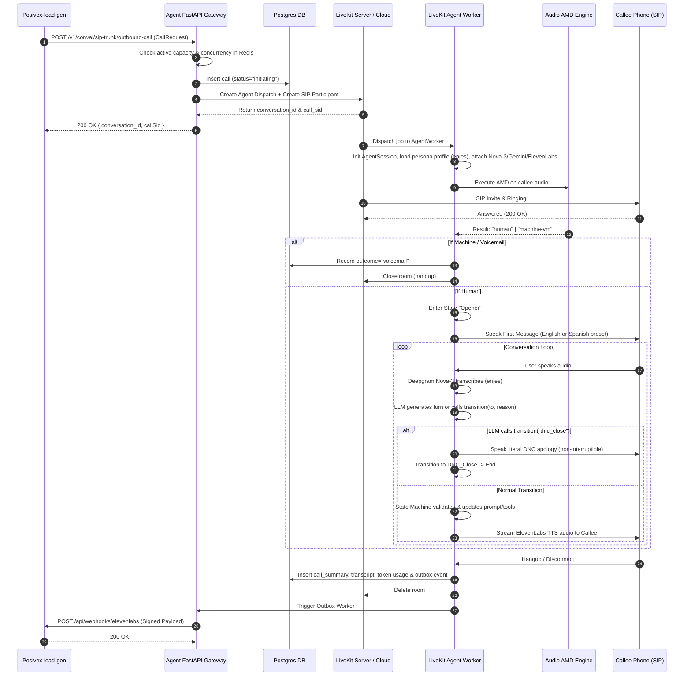
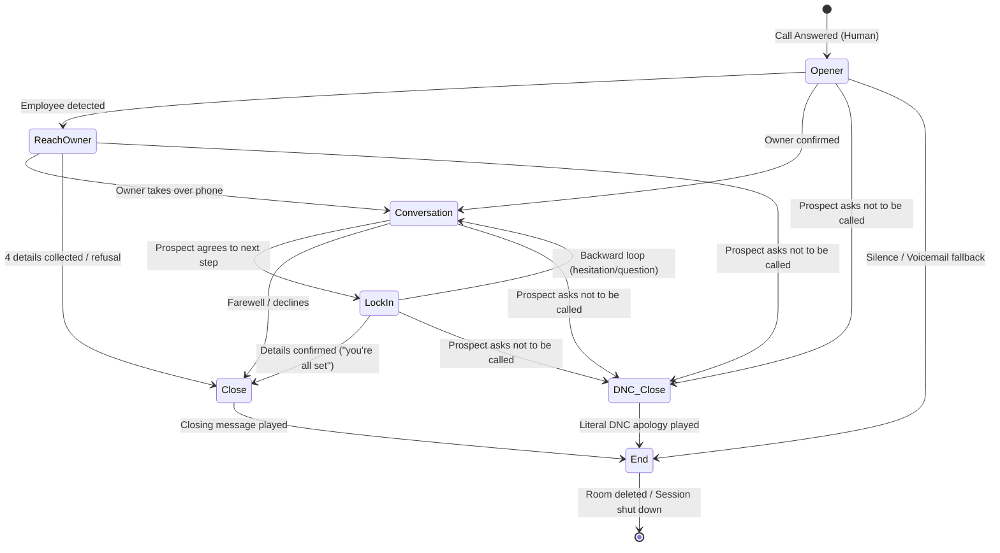

> **Superseded.** The agent is now a single system prompt with three tools and a post-call outcome classifier. See `docs/SINGLE_PROMPT_MIGRATION_PLAN.md`. The state machine described below no longer exists.

# LiveKit Agents Outbound Sales Architecture Plan

> **Target Agent:** Posivex Clover/NRS Outbound Voice Agent (Amelia & Michael personas)  
> **Scope:** English and Spanish Only, Single Deepgram Nova-3 STT, Lead-Gen Managed DNC  
> **Source Platform:** ElevenLabs Conversational AI v5 Workflow  
> **Target Framework:** `livekit-agents==1.8.10` (Python 3.12, async/await)  
> **Status:** Architecture Specification — Plan Only (No Production Code)

---

## 1. System Architecture & Component Overview

```
                                  +----------------------------------------------+
                                  |            Posivex-lead-gen (Next.js)        |
                                  |  - Handles lead suppression & pre-dial DNC   |
                                  +----------------------------------------------+
                                         |                                  ^
                           Outbound Call | (HTTP POST)                      | Webhook (HMAC-SHA256)
                                         v                                  |
               +------------------------------------+                       |
               |      Voice Agent API (FastAPI)     |                       |
               |  - ElevenLabs Emulation Layer      |                       |
               |  - Native /api/v1/calls            |                       |
               |  - Concurrency & Capacity Check    |                       |
               +------------------------------------+                       |
                      |                         |                           |
                      | Dispatch                | Writes                    |
                      v                         v                           |
         +------------------------+   +-------------------+                 |
         | LiveKit Cloud / Server |   | Postgres Database |                 |
         |  - WebRTC Room         |   |  - calls          |                 |
         |  - Audio Tracks        |   |  - webhook_outbox |-----------------+
         |  - SIP Outbound Trunk  |   |  - transcripts    | (Outbox Worker)
         +------------------------+   +-------------------+
                      |
                      | Dispatches job
                      v
         +----------------------------------------------------+
         |          LiveKit Python Agent Worker Process       |
         |  +----------------------------------------------+  |
         |  |         PersonaAgent (Amelia / Michael)      |  |
         |  |  +----------------------------------------+  |  |
         |  |  |        Explicit State Machine          |  |  |
         |  |  |  - Opener     -> ReachOwner           |  |  |
         |  |  |  - Conversation <-> LockIn             |  |  |
         |  |  |  - Close / DNC_Close -> End            |  |  |
         |  |  +----------------------------------------+  |  |
         |  |  - Audio Answering Machine Detection (AMD)|  |
         |  |  - Deepgram Nova-3 STT (en / es / multi)  |  |
         |  |  - Google Gemini LLM + FallbackAdapter   |  |
         |  |  - ElevenLabs v3 Conversational TTS      |  |
         |  |  - Token & Character Cost Accumulator    |  |
         |  +----------------------------------------------+  |
         +----------------------------------------------------+
```

### 1.1 Core Components
1. **API Service (`services/api`):** FastAPI app providing ElevenLabs compatibility routes (`/v1/convai/*`) and native LiveKit dispatch endpoints (`/api/v1/calls`). Validates phone format, checks campaign concurrency, records call initiation in Postgres, and dispatches jobs to LiveKit. (Pre-dial suppression is handled upstream by `Posivex-lead-gen`).
2. **Agent Worker (`services/agent`):** Standalone Python service running `livekit.agents.AgentServer`. Manages outbound WebRTC sessions, layered AMD, state machine transitions, and audio streaming.
3. **Outbox Worker (`services/outbox`):** Transactional polling worker delivering post-call webhook payloads to `Posivex-lead-gen` with HMAC-SHA256 signing and exponential backoff.
4. **Data Store (`Postgres`):** Relational store with ACID guarantees for call logs, state machine events, transcripts, token usage costs, and webhook outbox.
5. **Cache / Concurrency Lock (`Redis`):** Atomic counters for active campaign calls, system-wide call caps, and dial idempotency locks.

---

## 2. End-to-End Data Flow (Mermaid)



---

## 3. Explicit State Machine Definition

The agent state machine replaces ElevenLabs' LLM-evaluated natural language edge conditions with an explicit, programmatic transition graph.



### 3.1 State Specifications Table

| State | Entry Behavior | Prompt Fragment File | Allowed Tools | Allowed Transitions (`to`) | Turn Eagerness | LLM Model |
|---|---|---|---|---|---|---|
| `opener` | `wait_for_user` | `prompts/nodes/node_1_opener.md` | `skip_turn`, `transition` | `reach_owner`, `conversation`, `dnc_close`, `end` | Eager (`min_endpointing=0.3s`) | `gemini-3.5-flash-lite` |
| `reach_owner` | `generate_immediately` | `prompts/nodes/node_2_reach_owner.md` | `skip_turn`, `record_owner_detail`, `transition` | `conversation`, `close`, `dnc_close` | Normal (`min_endpointing=0.5s`) | `gemini-3.5-flash-lite` |
| `conversation` | `generate_immediately` | `prompts/nodes/node_3_conversation.md` + inline KB | `skip_turn`, `transition` | `lock_in`, `close`, `dnc_close` | Normal (`min_endpointing=0.5s`) | `gemini-3.5-flash` |
| `lock_in` | `generate_immediately` | `prompts/nodes/node_4_lock_in.md` | `skip_turn`, `record_demo_booking`, `record_email`, `transition` | `conversation`, `close`, `dnc_close` | Patient (`min_endpointing=1.0s`) | `gemini-3.5-flash-lite` |
| `close` | `generate_immediately` | `prompts/nodes/node_5_close.md` | `transition` | `end` | Fast | `gemini-3.5-flash-lite` |
| `dnc_close` | `generate_immediately` | (Literal string speech) | None | `end` | Non-interruptible | None (canned TTS) |
| `end` | Terminal | None | None | None | N/A | None |

### 3.2 State Transition Enforcement & DNC Parity
The LLM requests transitions using a unified `@function_tool`:
```python
@function_tool
async def transition(self, context: RunContext, to: str, reason: str) -> str:
    """Request a transition to another state in the sales conversation.
    
    Args:
        to: Target state name ('reach_owner', 'conversation', 'lock_in', 'close', 'dnc_close')
        reason: Justification based on what the prospect said
    """
    return await self.state_machine.request_transition(to, reason)
```

**DNC Parity Rule:**
- When the prospect says "don't call again", "take us off your list", or "stop calling", the prompt instructs the LLM to call `transition("dnc_close", reason=...)`.
- In `dnc_close` state, the agent speaks the non-interruptible literal string:
  *"Understood, my apologies. I'll make sure we don't call this number again. Take care."*
- The outcome is recorded as `do_not_call` and reported in the post-call webhook.
- The LLM has **no hangup tool**; only the state machine terminates calls.
- The state machine transition logic and DNC edge are pure Python and 100% testable via unit tests.

---

## 4. Repository Layout

```
posivex-livekit-agent/
├── pyproject.toml                 # uv package definition (Python >=3.12)
├── ruff.toml                      # Ruff linter/formatter config
├── Taskfile.yaml (or justfile)    # Cross-platform task runner
├── .env.example                   # Committed template of all required env vars
├── docker-compose.yml             # Multi-profile compose topology
├── Dockerfile                     # Multi-stage production container
│
├── config/
│   ├── defaults.yaml              # Global default settings
│   ├── profiles/                  # Persona profiles (en and es support)
│   │   ├── amelia.yaml            # Amelia voice, English & Spanish first messages
│   │   └── michael.yaml           # Michael voice, English & Spanish first messages
│   └── experiments/               # A/B testing experiment definitions
│
├── prompts/
│   ├── amelia/
│   │   ├── global.j2              # Persona instructions with Jinja variables
│   │   └── knowledge_base.md      # Inline knowledge base
│   ├── michael/
│   │   ├── global.j2
│   │   └── knowledge_base.md
│   └── nodes/                     # Shared node prompts
│       ├── node_1_opener.md
│       ├── node_2_reach_owner.md
│       ├── node_3_conversation.md
│       ├── node_4_lock_in.md
│       └── node_5_close.md
│
├── src/
│   ├── __init__.py
│   ├── config.py                  # pydantic-settings layered configuration
│   ├── logging.py                 # Structured JSON logging with call_id context
│   │
│   ├── db/                        # Database layer (Postgres + SQLAlchemy 2)
│   │   ├── base.py                # Async engine & sessionmaker
│   │   ├── models.py              # Declarative tables (calls, events, transcripts, outbox)
│   │   └── migrations/            # Alembic migrations
│   │
│   ├── fsm/                       # Finite State Machine engine
│   │   ├── state_machine.py       # FSM controller
│   │   ├── states.py              # State definitions & allowed edges
│   │   └── transitions.py         # Validation & history tracking
│   │
│   ├── tools/                     # LLM Function Tools
│   │   ├── transition.py          # Unified transition tool
│   │   ├── skip_turn.py           # Hold state handler
│   │   └── data_capture.py        # Email, name, callback detail tools
│   │
│   ├── providers/                 # Swappable Component Registry
│   │   ├── stt_factory.py         # Deepgram Nova-3 (en, es, multi)
│   │   ├── llm_factory.py         # Google Gemini + FallbackAdapter
│   │   ├── tts_factory.py         # ElevenLabs v3 dialogue TTS
│   │   └── telephony.py           # Pluggable TelephonyProvider (Mock/SIP)
│   │
│   ├── agent/                     # LiveKit Worker
│   │   ├── persona_agent.py       # Single long-lived Agent subclass
│   │   ├── session_runner.py      # Entrypoint & shutdown callbacks
│   │   └── cost_tracker.py        # Token & character cost accounting
│   │
│   ├── api/                       # FastAPI Server
│   │   ├── main.py                # FastAPI app
│   │   ├── routes_elevenlabs.py   # Emulation layer (/v1/convai/*)
│   │   ├── routes_calls.py        # Native API (/api/v1/calls)
│   │   └── routes_health.py       # Health & Prometheus metrics
│   │
│   └── outbox/                    # Webhook Outbox Worker
│       └── worker.py              # Async loop delivering signed webhooks
│
├── spikes/                        # Verification scripts (benchmarks/tests)
│   ├── spike_01_eleven_v3.py
│   ├── spike_03_nova3_eval.py
│   └── check_gemini.py
│
├── tests/                         # Automated Test Suite
│   ├── test_fsm.py                # FSM state transition & DNC edge unit tests
│   ├── test_webhook_signing.py    # ElevenLabs HMAC-SHA256 signature parity
│   └── simulations/               # W1-W20 matrix text simulations
│       ├── test_w1_owner.py
│       ├── test_w2_employee.py
│       └── test_w7_dnc.py
│
└── docs/                          # Architecture & contract documents
    ├── ARCHITECTURE_PLAN.md
    ├── BACKEND_CONTRACT.md
    ├── DECISIONS.md
    ├── PROGRESS.md
    └── SPIKES.md
```

---

## 5. Layered Configuration Schema (`pydantic-settings`)

Configuration resolves in order of increasing precedence:
`defaults.yaml` → `profiles/<persona>.yaml` → `.env` → `per_call_overrides` (allow-listed keys).

```python
from pydantic import BaseModel, Field
from pydantic_settings import BaseSettings, SettingsConfigDict
from typing import Literal, Dict, Any, Optional, List

class STTConfig(BaseModel):
    provider: Literal["deepgram", "assemblyai"] = "deepgram"
    model: str = "nova-3"
    # Mode: per-call fixed ("en-US" / "es") or multilingual ("multi")
    language_mode: Literal["fixed", "multi"] = "fixed"
    default_language: Literal["en-US", "es"] = "en-US"

class LLMConfig(BaseModel):
    provider: Literal["google", "openai"] = "google"
    global_model: str = "gemini-3.5-flash-lite"
    conversation_model: str = "gemini-3.5-flash"
    fallback_model: str = "gemini-2.5-flash"
    cascade_timeout_secs: float = 4.0
    temperature: float = 0.0
    thinking_level: Literal["MINIMAL", "LOW", "MEDIUM", "HIGH"] = "MINIMAL"

class TTSConfig(BaseModel):
    provider: Literal["elevenlabs", "cartesia"] = "elevenlabs"
    model: str = "eleven_v3_conversational"
    voice_id: str = "eXpIbVcVbLo8ZJQDlDnl"  # Amelia default
    streaming_latency: int = 3
    encoding: str = "pcm_16000"

class TurnConfig(BaseModel):
    silence_end_call_timeout: float = 15.0
    max_duration_seconds: float = 600.0
    user_away_timeout: float = 15.0
    false_interruption_timeout: float = 0.8
    resume_false_interruption: bool = True
    min_interruption_words: int = 3
    max_tool_steps: int = 5

class AppConfig(BaseSettings):
    env: Literal["development", "production", "test"] = "development"
    database_url: str = Field(..., env="DATABASE_URL")
    redis_url: str = Field("redis://localhost:6379/0", env="REDIS_URL")
    livekit_url: str = Field(..., env="LIVEKIT_URL")
    livekit_api_key: str = Field(..., env="LIVEKIT_API_KEY")
    livekit_api_secret: str = Field(..., env="LIVEKIT_API_SECRET")
    gemini_api_key: str = Field(..., env="GEMINI_API_KEY")
    elevenlabs_api_key: str = Field(..., env="ELEVENLABS_API_KEY")
    deepgram_api_key: str = Field(..., env="DEEPGRAM_API_KEY")
    webhook_secret: str = Field(..., env="ELEVENLABS_WEBHOOK_SECRET")
    lead_gen_webhook_url: str = Field("http://localhost:3000/api/webhooks/elevenlabs", env="LEAD_GEN_WEBHOOK_URL")

    stt: STTConfig = STTConfig()
    llm: LLMConfig = LLMConfig()
    tts: TTSConfig = TTSConfig()
    turn: TurnConfig = TurnConfig()

    model_config = SettingsConfigDict(env_file=".env", extra="ignore")
```

---

## 6. PostgreSQL Database Schema (SQLAlchemy 2 Async + Alembic)

> Note: `dnc_records` table has been removed. Pre-dial suppression remains in `Posivex-lead-gen`.

```sql
-- Active and historical voice calls
CREATE TABLE calls (
    id UUID PRIMARY KEY DEFAULT gen_random_uuid(),
    call_id VARCHAR(64) UNIQUE NOT NULL, -- Client-provided or generated
    lead_id VARCHAR(64) NULL,            -- Posivex MongoDB Lead ID
    campaign_id VARCHAR(64) NULL,        -- Posivex MongoDB Campaign ID
    phone_number VARCHAR(32) NOT NULL,
    persona VARCHAR(32) NOT NULL DEFAULT 'amelia',
    language VARCHAR(8) NOT NULL DEFAULT 'en', -- 'en' or 'es'
    status VARCHAR(32) NOT NULL,         -- initiating, active, completed, failed
    outcome VARCHAR(64) NULL,            -- call_outcome enum
    outcome_rationale TEXT NULL,
    duration_secs INTEGER DEFAULT 0,
    started_at TIMESTAMPTZ NULL,
    ended_at TIMESTAMPTZ NULL,
    termination_reason VARCHAR(64) NULL,
    experiment_id VARCHAR(64) NULL,
    component_profile VARCHAR(64) NOT NULL DEFAULT 'default',
    prompt_version VARCHAR(64) NOT NULL,
    livekit_room_name VARCHAR(128) NOT NULL,
    livekit_dispatch_id VARCHAR(128) NULL,
    sip_call_sid VARCHAR(128) NULL,
    variables_sent JSONB NOT NULL DEFAULT '{}'::jsonb,
    created_at TIMESTAMPTZ NOT NULL DEFAULT NOW(),
    updated_at TIMESTAMPTZ NOT NULL DEFAULT NOW()
);
CREATE INDEX idx_calls_lead ON calls(lead_id);
CREATE INDEX idx_calls_status ON calls(status);

-- State machine audit events (replaces ElevenLabs node analytics)
CREATE TABLE call_events (
    id BIGSERIAL PRIMARY KEY,
    call_id UUID NOT NULL REFERENCES calls(id) ON DELETE CASCADE,
    event_type VARCHAR(64) NOT NULL, -- state_transition, tool_call, amd_result
    from_state VARCHAR(32) NULL,
    to_state VARCHAR(32) NULL,
    payload JSONB NOT NULL DEFAULT '{}'::jsonb,
    created_at TIMESTAMPTZ NOT NULL DEFAULT NOW()
);
CREATE INDEX idx_call_events_call ON call_events(call_id);

-- Turn-by-turn conversation transcript
CREATE TABLE transcripts (
    id BIGSERIAL PRIMARY KEY,
    call_id UUID NOT NULL REFERENCES calls(id) ON DELETE CASCADE,
    turn_index INTEGER NOT NULL,
    role VARCHAR(16) NOT NULL, -- agent, user, system
    message TEXT NOT NULL,
    time_in_call_secs NUMERIC(6, 2) NOT NULL,
    interrupted BOOLEAN NOT NULL DEFAULT FALSE,
    created_at TIMESTAMPTZ NOT NULL DEFAULT NOW()
);
CREATE INDEX idx_transcripts_call ON transcripts(call_id);

-- Cost & token consumption accounting
CREATE TABLE usage_costs (
    id UUID PRIMARY KEY DEFAULT gen_random_uuid(),
    call_id UUID NOT NULL REFERENCES calls(id) ON DELETE CASCADE,
    stt_seconds NUMERIC(8, 2) DEFAULT 0.0,
    llm_prompt_tokens INTEGER DEFAULT 0,
    llm_completion_tokens INTEGER DEFAULT 0,
    llm_cached_tokens INTEGER DEFAULT 0,
    tts_characters INTEGER DEFAULT 0,
    estimated_stt_cost NUMERIC(8, 5) DEFAULT 0.0,
    estimated_llm_cost NUMERIC(8, 5) DEFAULT 0.0,
    estimated_tts_cost NUMERIC(8, 5) DEFAULT 0.0,
    total_cost NUMERIC(8, 5) DEFAULT 0.0,
    created_at TIMESTAMPTZ NOT NULL DEFAULT NOW()
);

-- Transactional Outbox for guaranteed webhook delivery
CREATE TABLE webhook_outbox (
    id UUID PRIMARY KEY DEFAULT gen_random_uuid(),
    call_id UUID NOT NULL REFERENCES calls(id) ON DELETE CASCADE,
    destination_url VARCHAR(512) NOT NULL,
    event_type VARCHAR(64) NOT NULL DEFAULT 'post_call_transcription',
    payload JSONB NOT NULL,
    status VARCHAR(32) NOT NULL DEFAULT 'pending', -- pending, delivered, failed
    attempts INTEGER NOT NULL DEFAULT 0,
    next_attempt_at TIMESTAMPTZ NOT NULL DEFAULT NOW(),
    last_error TEXT NULL,
    delivered_at TIMESTAMPTZ NULL,
    created_at TIMESTAMPTZ NOT NULL DEFAULT NOW()
);
CREATE INDEX idx_outbox_pending ON webhook_outbox(status, next_attempt_at) WHERE status = 'pending';
```

---

## 7. API Specification (FastAPI)

### 7.1 ElevenLabs Emulation Layer
- `POST /v1/convai/sip-trunk/outbound-call`
- `POST /v1/convai/twilio/outbound-call`
  - Validates `xi-api-key`.
  - Reserves concurrency slot in Redis.
  - Inserts pending row in `calls`.
  - Creates LiveKit room & agent dispatch.
  - Returns `{ "success": true, "conversation_id": call_id, "callSid": call_id }`.

### 7.2 Native API Routes
- `POST /api/v1/calls`: Accepts validated `CallRequest` Pydantic payload.
- `GET /api/v1/calls/{id}`: Returns live call status, current FSM state, transcript, and costs.
- `POST /api/v1/calls/{id}/terminate`: Force-terminates an active call.
- `GET /health`: Liveness probe (checks DB & Redis connections).
- `GET /metrics`: Prometheus formatted metrics (calls in progress, latency histograms, cost summaries).

---

## 8. Docker Topology & Network Profiles

```yaml
version: '3.8'

services:
  postgres:
    image: postgres:16-alpine
    profiles: ["core", "all"]
    environment:
      POSTGRES_DB: voice_agent
      POSTGRES_USER: postgres
      POSTGRES_PASSWORD: password
    ports:
      - "5432:5432"
    volumes:
      - pgdata:/var/lib/postgresql/data

  redis:
    image: redis:7-alpine
    profiles: ["core", "all"]
    ports:
      - "6379:6379"

  livekit-server:
    image: livekit/livekit-server:v1.8.2
    profiles: ["core", "all"]
    command: --config /etc/livekit.yaml
    ports:
      - "7880:7880"         # HTTP / WebSocket
      - "7881:7881"         # TCP WebRTC
      - "7882:7882/udp"     # Single-port UDP mux for Windows dev
    volumes:
      - ./config/livekit-dev.yaml:/etc/livekit.yaml

  agent-api:
    build: .
    profiles: ["core", "api", "all"]
    command: uvicorn src.api.main:app --host 0.0.0.0 --port 8000
    env_file: .env
    ports:
      - "8000:8000"
    depends_on:
      - postgres
      - redis

  agent-worker:
    build: .
    profiles: ["agent", "all"]
    command: python -m src.agent.session_runner dev
    env_file: .env
    depends_on:
      - livekit-server
      - postgres
      - redis

  outbox-worker:
    build: .
    profiles: ["agent", "all"]
    command: python -m src.outbox.worker
    env_file: .env
    depends_on:
      - postgres

  # Disabled until SIP trunk credentials are provided
  livekit-sip:
    image: livekit/sip:latest
    profiles: ["sip"]
    command: --config /etc/sip.yaml
    volumes:
      - ./config/sip.yaml:/etc/sip.yaml
    depends_on:
      - livekit-server

volumes:
  pgdata:
```

---

## 9. Phased Implementation Roadmap

### Phase 1: Foundation & Spikes (Milestone: Spikes Complete & Core Harness Ready)
- [ ] Run throwaway test spikes (`spikes/`):
  - ElevenLabs v3 conversational streaming benchmark (50 samples, en + es).
  - Deepgram Nova-3 evaluation on real phone audio (fixed `en`/`es` vs `multi`).
  - LiveKit FallbackAdapter provider failure test.
- [ ] Set up Docker Compose `core` profile (Postgres, Redis, LiveKit single-port dev).
- [ ] Initialize SQLAlchemy 2 async models & run baseline Alembic migration.
- **Acceptance Criteria:** All spikes report PASS; database connects and runs migrations.

### Phase 2: State Machine & Prompts (Milestone: FSM Unit Tested)
- [ ] Build the FSM engine (`src/fsm/`): states, validation, allowed transitions, DNC parity edge, and history logging.
- [ ] Write unit tests verifying that all allowed edges succeed and illegal transitions are rejected.
- [ ] Port the shared node prompts and bilingual guardrails to Jinja templates under `prompts/`.
- [ ] Port the W1–W20 test matrix from `Test-plan.md` to automated unit/simulation tests (testing the LLM-driven DNC path).
- **Acceptance Criteria:** W1–W20 automated text simulation tests pass with 100% assertion compliance.

### Phase 3: LiveKit Voice Agent Worker (Milestone: Console Mode Conversational)
- [ ] Implement `PersonaAgent` subclassing `livekit.agents.Agent`.
- [ ] Hook `google.LLM` with `FallbackAdapter` and minimal thinking level.
- [ ] Hook `elevenlabs.TTS` with `eleven_v3_conversational` streaming.
- [ ] Hook `deepgram.STT` Nova-3 with English and Spanish presets.
- [ ] Integrate layered AMD context manager.
- [ ] Connect token and character cost accounting to Postgres.
- **Acceptance Criteria:** Live browser console call runs all 5 pitch beats naturally without WebSocket dropouts.

### Phase 4: API Service & Webhook Outbox (Milestone: Zero-Change Lead-Gen Integration)
- [ ] Implement FastAPI ElevenLabs emulation endpoints (`/v1/convai/*`).
- [ ] Implement native `/api/v1/calls` with Pydantic `CallRequest` validation.
- [ ] Implement Transactional Outbox worker with HMAC-SHA256 signature generator.
- [ ] Connect `Posivex-lead-gen` to emulated endpoint in local development.
- **Acceptance Criteria:** Lead-gen dials, call executes, and lead-gen receives signed webhook, updating its database cleanly.

### Phase 5: Telephony & Hardening (Milestone: Production SIP Ready)
- [ ] Implement `LiveKitSIPProvider` behind `TelephonyProvider` interface.
- [ ] Run A/B benchmark comparing LiveKit system against ElevenLabs production baseline.
- [ ] Configure Prometheus metrics dashboard for call latency (p50/p95) and costs.
- **Acceptance Criteria:** Production latency p50 < 800ms; cost per call reduced by >=60% compared to ElevenLabs' $0.08/min fee.
